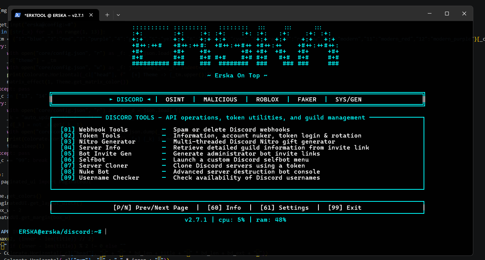

#  ERSKA MULTITOOL

**The Ultimate All-in-One Hacking Toolkit**

ERSKA MULTITOOL is a versatile hacking (Open Source Intelligence) toolkit designed to simplify online investigations, information gathering and digital research.

Built to bring multiple intelligence-gathering utilities together in one place, ERSKA MULTITOOL aims to provide a simple, efficient and accessible experience for cybersecurity enthusiasts, researchers and OSINT investigators.

##  Features

- A lot of features like OSINT.VIRUS.DISCORD (selfbot, nuke) and a lot to discover by yourself!
*Features may vary depending on the current version of the project.*

##  Getting Started

1. Clone this repository.
2. Install the required dependencies.
3. Configure the tool if necessary.
4. Launch ERSKA MULTITOOL.
5. Explore the available OSINT modules.

##  Disclaimer

ERSKA MULTITOOL is intended for educational, research and legitimate cybersecurity purposes only.

Users are responsible for ensuring that their activities comply with applicable laws and regulations.

Do not use this toolkit to harass, stalk, invade someone's privacy or access information without authorization.

##  Developer

**Created by Erska**

Part of the **DECRYPT EMPIRE** group.

##  Support

If you find this project useful, consider giving the repository a star ⭐

---

  

  <b>ERSKA MULTITOOL v2.7.1</b>
   
  The Ultimate All-in-One OSINT Toolkit

  <b>ERSKA MULTITOOL</b>
   
  Open Source Intelligence. Simplified.
    
  Made with ❤️ by <b>Erska</b>

